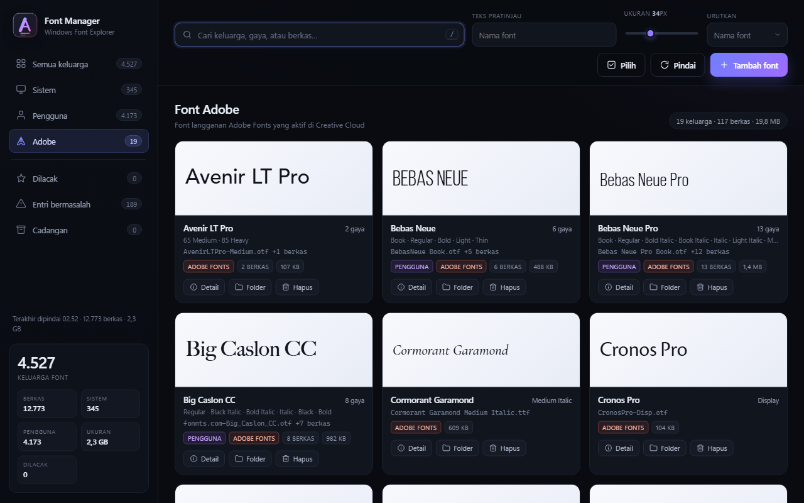
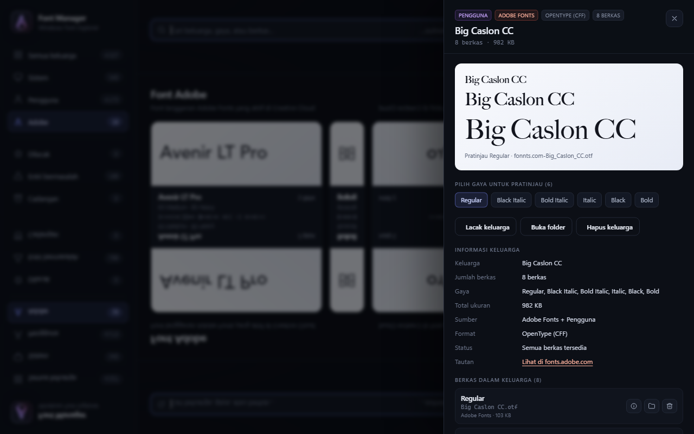

<div align="center">


# Font Manager

**Manajer font lokal untuk Windows** — pindai, pratinjau, lacak, cadangkan, dan hapus font.
Termasuk font langganan **Adobe Fonts** dari Creative Cloud.

[](LICENSE)
[](https://github.com/inomixstudio/FontManager/releases/latest)
[](#persyaratan)
[](https://nodejs.org)
[](#arsitektur)

</div>



---

## Daftar isi

- [Fitur](#fitur)
- [Tangkapan layar](#tangkapan-layar)
- [Persyaratan](#persyaratan)
- [Menjalankan](#menjalankan)
- [Panduan singkat](#panduan-singkat)
- [Adobe Fonts](#adobe-fonts)
- [Izin administrator (UAC)](#izin-administrator-uac)
- [Data yang disimpan](#data-yang-disimpan)
- [Arsitektur](#arsitektur)
- [Batasan](#batasan)
- [Pemecahan masalah](#pemecahan-masalah)
- [Keamanan](#keamanan)
- [Berkontribusi](#berkontribusi)
- [Lisensi](#lisensi)

---

## Fitur

### Pemindaian & pratinjau
- **Deteksi lengkap** — membaca registri Windows (HKLM + HKCU) dan folder font sistem/pengguna,
  termasuk berkas yang belum terdaftar dan font langganan Adobe Fonts.
- **Satu kartu per keluarga** — seluruh berkas dengan keluarga yang sama (Regular, Bold, Italic,
  Light, dan seterusnya) digabung menjadi satu kartu, termasuk koleksi TTC/OTC. Nama keluarga
  lama yang memecah gaya (`Acre-Black`, `AmlightSemiBold`, `FilsonProBlack`, `Futura Bk BT`)
  dikenali sebagai satu keluarga; varian desain yang memang berbeda (`Barlow Condensed`,
  `IvyOra Display` vs `IvyOra Text`) tetap berdiri sendiri.
- **Pratinjau asli** — setiap kartu dirender memakai berkas font aslinya, dengan teks kustom
  opsional dan pengatur ukuran.
- **Detail font** — nama lengkap, PostScript, berat, hak sematan, wajah dalam koleksi (TTC/OTC),
  entri registri, lokasi berkas, dan tombol buka Explorer.

### Pengelolaan
- **Pencarian & filter** — Semua / Sistem / Pengguna / Kustom / **Adobe** / Dilacak /
  Entri bermasalah / Cadangan.
- **Lacak keluarga** — tandai satu keluarga dengan satu klik; semua gayanya ikut terlacak dan
  tersimpan permanen. Keluarga yang berkasnya sedang tidak terdeteksi tetap tampil dengan chip
  **tidak terdeteksi** dan tombol **Lepas**.
- **Hapus per keluarga atau massal** — satu operasi untuk seluruh berkas + entri registri.
  Font sistem memakai elevasi UAC; font inti Windows butuh konfirmasi khusus. Maksimal 2.000
  berkas per operasi.
- **Cadangan otomatis & pemulihan** — berkas dicadangkan lebih dulu ke `data/backups`, lalu dapat
  dipulihkan kapan saja dari tab **Cadangan**. Tombol **Cadangkan** juga tersedia di detail font
  dan detail famili Adobe untuk membuat salinan kapan saja; cadangan manual yang dipulihkan saat
  berkas asli masih ada disalin sebagai font baru di folder font pengguna.
- **Pasang font** — `.ttf`, `.otf`, `.ttc`, `.otc` untuk akun Anda (tanpa administrator), lewat
  tombol atau seret-lepas.
- **Progres rinci** — panel progres menampilkan status per berkas (Menunggu → Tercadangkan →
  Menghapus… → Dihapus), persentase, dan ringkasan hasil; bisa disembunyikan dan dibuka kembali.
- **Performa** — daftar dirender bertahap (60 per halaman), payload daftar font di-cache
  (JSON + gzip), dan pemindaian ribuan berkas berjalan sekali per perubahan.

## Tangkapan layar

| Detail keluarga dengan pratinjau tiap gaya |
| --- |
|  |

## Persyaratan

| Komponen | Keterangan |
| --- | --- |
| Windows 10/11 | Registri, UAC, dan PowerShell dibutuhkan |
| [Node.js 18+](https://nodejs.org) | Runtime server lokal |
| WebView2 Runtime | Umumnya sudah terpasang di Windows 10/11 modern |

Tidak ada `npm install`: aplikasi berjalan **tanpa dependensi eksternal**.

## Menjalankan

1. Unduh `FontManager-<versi>.zip` dari [rilis terbaru](https://github.com/inomixstudio/FontManager/releases/latest).
2. Ekstrak ke folder mana pun.
3. Klik dua kali **`start.bat`**.

Peluncur membuka jendela desktop mandiri (host WinForms ringan + WebView2). Server hanya
mendengarkan `127.0.0.1` pada port acak dan berhenti otomatis saat jendela ditutup. Menjalankan
`start.bat` lagi akan mengaktifkan jendela yang sudah terbuka, bukan membuka instans kedua.

Menjalankan langsung tanpa host desktop juga bisa:

```bat
set FM_NO_OPEN=1
node server.js
```

Lalu buka `http://127.0.0.1:4317` (atau port yang tercetak di konsol).

## Panduan singkat

| Tindakan | Cara |
| --- | --- |
| Cari font | Ketik di kolom pencarian, atau tekan <kbd>/</kbd> |
| Ubah pratinjau | Kosongkan teks untuk memakai nama font; geser slider ukuran |
| Lihat gaya | Klik kartu → pilih gaya untuk pratinjau |
| Lacak | Klik ikon bintang pada kartu, atau **Lacak keluarga** di detail |
| Hapus | **Hapus** pada kartu (seluruh keluarga) atau hapus satu berkas di detail |
| Hapus massal | **Pilih** → tandai kartu → **Hapus N berkas** |
| Cadangkan massal | **Pilih** → tandai kartu → **Cadangkan N berkas** |
| Pulihkan | Tab **Cadangan** → **Pulihkan** |
| Buka folder cadangan | Tab **Cadangan** → **Buka folder** (folder `data/backups`) |
| Cadangkan | Tombol **Cadangkan** di detail font, atau di detail famili Adobe |
| Pasang | **Tambah font** atau seret berkas ke jendela |

## Adobe Fonts

Font langganan Adobe Fonts yang aktif disinkronkan Creative Cloud ke
`%APPDATA%\Adobe\CoreSync\plugins\livetype\`. Font Manager membacanya langsung, sehingga font
tersebut muncul di tab **Adobe** lengkap dengan pratinjau dan tautan ke fonts.adobe.com.

- Bisa **dilacak, dicadangkan, dihapus, dan dipulihkan** seperti font biasa.
- Tombol **Cadangkan** di detail famili menyimpan seluruh berkas Adobe keluarga sekaligus; di
  detail satu berkas tersedia tombol yang sama. Cadangan manual diberi label **Manual** di tab
  **Cadangan**.
- Saat dihapus, entri *entitlement* Adobe ikut dicabut agar Creative Cloud tidak mengunduhnya
  kembali; pemulihan dari cadangan mendaftarkannya kembali.
- ID font memakai id sinkronisasi (`adobe-<id>`), bukan path berkas, sehingga pelacakan tetap
  utuh ketika Creative Cloud memindahkan berkasnya antar subfolder.
- Untuk berhenti berlangganan sebuah keluarga secara permanen, gunakan aplikasi Creative Cloud.

> **Catatan:** font Adobe adalah lisensi langganan, bukan milik Anda. Aplikasi ini hanya mengelola
> salinan lokalnya di komputer Anda.

## Izin administrator (UAC)

| Lokasi | Kebutuhan |
| --- | --- |
| `%LOCALAPPDATA%\Microsoft\Windows\Fonts` (HKCU) | Tanpa administrator |
| `C:\Windows\Fonts` (HKLM) | Administrator — jendela UAC muncul |

Semua perubahan sistem dijalankan oleh skrip PowerShell yang dibuat aplikasi. Jika UAC ditolak,
tidak ada perubahan apa pun yang dilakukan.

## Data yang disimpan

| Lokasi | Isi |
| --- | --- |
| `data/tracked.json` | Daftar font/keluarga yang dilacak |
| `data/backups.json` | Indeks cadangan font |
| `data/backups/` | Salinan berkas font yang dihapus (maksimal 300 cadangan) |
| `%LOCALAPPDATA%\FontManager\` | Profil WebView2 dan `error.log` host desktop |

Folder `data/` dibuat otomatis, tidak di-commit, dan tidak pernah dikirim ke internet.

## Arsitektur

```
server.js              Server HTTP + API (Node.js, tanpa dependensi)
lib/fontParser.js      Pembaca tabel sfnt (name, OS/2, head, TTC)
lib/registry.js        Pembacaan registri font Windows via PowerShell
lib/scanner.js         Pemindaian folder + registri, cache metadata
lib/adobeFonts.js      Font langganan Adobe Fonts (CoreSync + entitlement)
lib/manage.js          Hapus/pasang/pulihkan + skrip PowerShell & UAC
lib/store.js           Penyimpanan lacak & cadangan
public/                Antarmuka (HTML, CSS, JS tanpa framework)
desktop/               Host WinForms ringan + WebView2 Runtime
start.bat              Peluncur Windows
scripts/progresstest.js Uji end-to-end API progres (pasang → hapus → pulihkan)
docs/                  Tangkapan layar
```

Alur utama: UI (`public/`) → API lokal (`server.js`) → modul `lib/` → PowerShell untuk operasi
yang menyentuh registri/berkas sistem.

## Batasan

- Font inti Windows (mis. Segoe UI, Segoe UI Emoji, Marlett) ditandai **Inti sistem**;
  penghapusannya butuh centang konfirmasi dan sangat tidak disarankan.
- Aplikasi yang sedang berjalan biasanya baru melihat font baru/terhapus setelah dimulai ulang.
- Berkas `.fon`, `.fnt`, `.pfb`, dan `.pfm` terdeteksi tetapi tidak dapat dipratinjau.
- Font dengan berkas hilang tampil di **Entri bermasalah** dan entri registrinya dapat dibersihkan.
- Hanya untuk Windows; tidak ada dukungan macOS/Linux.

## Pemecahan masalah

| Gejala | Solusi |
| --- | --- |
| Jendela tidak terbuka | Jalankan `start.bat` lagi (instans macet dibersihkan otomatis). Periksa `%LOCALAPPDATA%\FontManager\error.log`. |
| "Node.js tidak ditemukan" | Pasang Node.js 18+ lalu jalankan ulang `start.bat`. |
| Komponen WebView2 tidak lengkap | Jalankan `desktop\build-desktop.bat`. |
| Font tidak muncul setelah dipasang | Klik **Pindai**, lalu mulai ulang aplikasi yang memakai font itu. |
| Font Adobe tidak terdeteksi | Pastikan font aktif di aplikasi Creative Cloud, lalu **Pindai**. |

## Keamanan

Aplikasi berjalan lokal dengan model keamanan berlapis: server hanya mengikat `127.0.0.1`,
memvalidasi header `Host` dan `Origin`, mewajibkan header `X-FM-Request` untuk operasi tulis,
menolak path traversal, dan memakai WebView2 dengan ekstensi/DevTools dimatikan.

Asal yang diterima: tanpa `Origin` (klien native), `localhost`/`127.0.0.1` (UI aplikasi dan
alat lokal), skema `uxp:` (panel UXP Photoshop), serta `null` (file://). Asal jarak jauh —
termasuk situs web mana pun — tetap **ditolak** (403), sehingga perlindungan DNS rebinding
lewat pemeriksaan `Host` tetap utuh.

Celah keamanan **jangan** dilaporkan lewat issue publik — lihat [SECURITY.md](SECURITY.md).

## Berkontribusi

Saran, laporan bug, dan pull request diterima. Lihat [CONTRIBUTING.md](CONTRIBUTING.md) dan
[CHANGELOG.md](CHANGELOG.md). Partisipasi tunduk pada [Kode Etik](CODE_OF_CONDUCT.md).

## Lisensi

[MIT](LICENSE) © 2026 [inomixstudio](https://github.com/inomixstudio).

Font yang Anda kelola **tidak** termasuk dalam lisensi ini: setiap font tetap tunduk pada
lisensi masing-masing (termasuk lisensi langganan Adobe Fonts).
